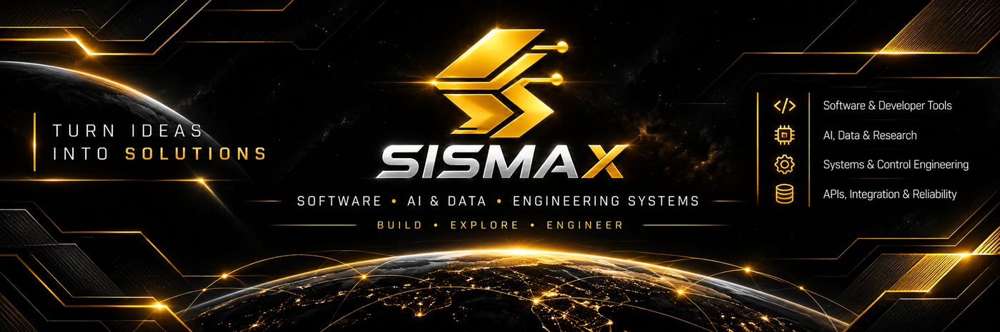

  

<h2 align="center">Yacine Zouaoui · Systems & Software Engineer · Founder @ SISMAX</h2>

  Designing and shipping reliable backend architectures, API integrations, applied AI tooling, and engineering systems—built for real-world scale and fault tolerance.

  
  
  

---

### What I Build

- **Backend & Distributed Workflows:** Fault-tolerant REST and webhook APIs, idempotent retry/recovery engines, state machines, and serverless deployments (`Python`, `FastAPI`, `SQLite`, `Cloudflare Workers`, `Docker`).
- **Applied AI & Data Systems:** Evidence-grounded RAG evaluation, claim-level verification, hybrid retrieval (`BM25` + semantic), and explainable ML diagnostics.
- **Control & Simulation Engineering:** First-principles nonlinear ODE digital twins, MIMO LQI control, Continuous-Discrete Extended Kalman Filtering (`CD-EKF`), and Fault Detection & Isolation (`FDI`).

---

### Featured Open-Source Systems

All repositories below ship with automated test suites and GitHub Actions CI.

| System | Problem Solved & Highlights | Stack |
| :--- | :--- | :--- |
| [**lead2meeting**](https://github.com/sismax01/lead2meeting) | Lead qualification, SLA stall detection, deduplication & idempotent recovery (`14` e2e tests · `MIT`) | `Python` · `FastAPI` · `Pydantic` · `SQLite` |
| [**GroundCheck**](https://github.com/sismax01/GroundCheck) | Evidence-grounded research, claim verification & reproducible RAG evaluation (`BM25` · `CI` · `MIT`) | `Python` · `FastAPI` · `NLP` · `BM25` |
| [**BridgeTest**](https://github.com/sismax01/BridgeTest) | Chaos engineering & end-to-end state verification for webhook & integration pipelines (`CLI` · `MIT`) | `Python` · `Webhooks` · `Chaos Testing` |
| [**quadtank-fdi**](https://github.com/sismax01/quadtank-fdi) | Nonlinear Quadruple-Tank Digital Twin, MIMO LQI, CD-EKF & `6`-fault FDI benchmark (`SciPy` · `MIT`) | `Python` · `SciPy` · `Control Theory` |
| [**BearingSense**](https://github.com/sismax01/BearingSense) | Explainable ML for bearing-fault diagnosis using Hilbert envelope analysis (`CWRU` · `XAI`) | `Python` · `scikit-learn` · `Signal Processing` |
| [**telegram-student-verification-bot**](https://github.com/sismax01/telegram-student-verification-bot) | Serverless trilingual (`EN`/`FR`/`AR`) verification & group gatekeeper bot (`Edge` · `MIT`) | `JavaScript` · `Cloudflare Workers` · `D1` |

---

### Technical Stack

| Domain | Technologies |
| :--- | :--- |
| **Languages** | `Python` · `JavaScript` · `SQL` · `HTML/CSS` |
| **Backend & Infra** | `FastAPI` · `Pydantic` · `REST / Webhooks` · `SQLite` · `Cloudflare Workers` · `Docker` · `GitHub Actions` |
| **AI, Data & Control** | `SciPy` · `NumPy` · `scikit-learn` · `RAG / BM25` · `Extended Kalman Filtering` · `MIMO LQI Control` |

---

### Currently Exploring & Open To

- **Building:** Production-grade backend systems, AI reliability benchmarks, and automated developer/business tooling under **SISMAX**.
- **Open to:** Software, backend, AI, or systems engineering roles, technical collaborations, and custom engineering engagements.
- **Reach me:** [zouaouiyacine07@gmail.com](mailto:zouaouiyacine07@gmail.com) · [LinkedIn](https://www.linkedin.com/in/yacine-zouaoui)
